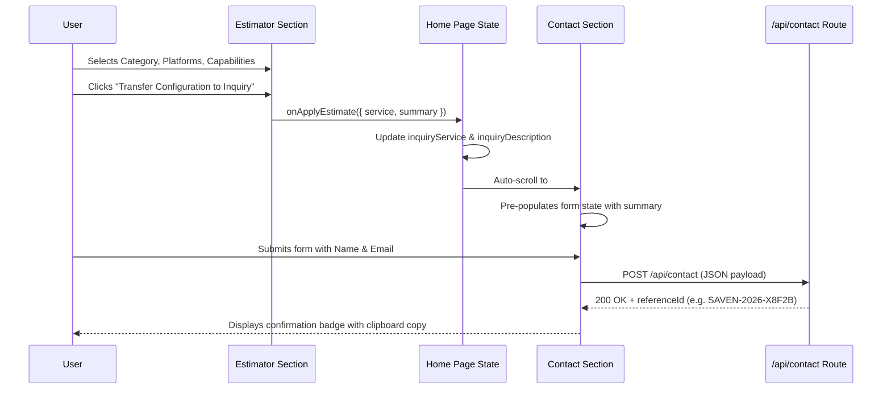

# System Architecture

This document describes the architectural patterns, component composition, state management, and rendering pipeline of the SAVEN application.

---

## 1. High-Level Architecture

The SAVEN website is engineered as a high-performance, single-page digital solutions agency portal built on Next.js 16 (App Router) and React 19. It fuses modern technical agency aesthetics with real-time interactive graphics.

```
                    ┌──────────────────────────────────────────────┐
                    │               RootLayout                     │
                    │   (Server Component: Fonts, SEO, JSON-LD)    │
                    └──────────────────────┬───────────────────────┘
                                           │
                                           ▼
                    ┌──────────────────────────────────────────────┐
                    │               HomePage ('use client')        │
                    │   (State Orchestrator: Scroll, Modal, Scope)  │
                    └──────────┬────────────────────────┬──────────┘
                               │                        │
             ┌─────────────────┴───────────────┐        │
             ▼                                 ▼        ▼
┌─────────────────────────┐       ┌────────────────────────┐
│     Visual FX Layer     │       │ Section Flow Components │
├─────────────────────────┤       ├────────────────────────┤
│ • ShatterIntro (ThreeJS)│       │ • Navbar               │
│ • LightRays (WebGL2)    │       │ • Hero                 │
│ • FlyingButton (Canvas) │       │ • Services             │
│ • TextMorph (Framer SVG)│       │ • Estimator            │
└─────────────────────────┘       │ • Process              │
                                  │ • About                │
                                  │ • Contact              │
                                  │ • Footer               │
                                  └───────────┬────────────┘
                                              │
                                              ▼
                                 ┌─────────────────────────┐
                                 │   Data Fixtures Layer   │
                                 │ • servicesData          │
                                 │ • principles / matrix   │
                                 │ • processSteps          │
                                 │ • siteConfig            │
                                 └─────────────────────────┘
```

---

## 2. Rendering Paradigm: Server vs. Client Boundary

1. **Server Boundary (`layout.tsx`):**
   - Renders as a Next.js Server Component.
   - Extracts font definitions via `next/font/google` (`Space_Grotesk`) with zero runtime CLS.
   - Generates static OpenGraph, Twitter, canonical, and Schema.org `ProfessionalService` JSON-LD metadata for search engine indexing.

2. **Client Orchestrator (`page.tsx`):**
   - Declared with `'use client'`.
   - Manages top-level application state:
     - `showIntro`: Controls visibility and unmounting of the full-screen Voronoi glass shatter sequence.
     - `inquiryService`: Holds selected service name passed across sections.
     - `inquiryDescription`: Pre-fills contact form with specifications generated by the interactive scope estimator.
   - Exposes imperative smooth-scrolling handlers to jump between hash targets (`#services`, `#contact`).

---

## 3. Data Architecture & Separation of Concerns

Content is completely separated from presentational components into statically typed fixtures located in `src/data/`:

- **[siteConfig.ts](file:///k:/Coding%20Projects/Saven/src/data/siteConfig.ts):** Global metadata, contact information, hours, social links, and navigation items.
- **[services.ts](file:///k:/Coding%20Projects/Saven/src/data/services.ts):** Comprehensive definitions for the 6 core agency offerings (custom software, modernization, academic, mobile, web, end-to-end), detailing deliverables, tech stack chips, and target client personas.
- **[process.ts](file:///k:/Coding%20Projects/Saven/src/data/process.ts):** 6-step project delivery methodology (`DISCOVER`, `PLAN`, `DESIGN`, `DEVELOP`, `TEST`, `DELIVER`) with timelines and sprint deliverables.
- **[about.ts](file:///k:/Coding%20Projects/Saven/src/data/about.ts):** Core values, technical differentiators, and full-stack capability matrices.
- **[types/index.ts](file:///k:/Coding%20Projects/Saven/src/types/index.ts):** TypeScript interface definitions (`ServiceItem`, `ProcessStep`, `Principle`, `ContactFormData`, `InquiryResponse`).

---

## 4. Interactive Simulation & Graphics Pipelines

The application incorporates four specialized visual computing engines:

### A. 3D Glass Shatter Engine (`ShatterType.tsx`)
- **Technology:** Three.js + custom Voronoi shard fragmentation.
- **Mechanism:** Builds polygonal 3D extruded geometry representing brand typography and logo assets. Calculates Voronoi fracture sites across planar faces.
- **Lifecycle:**
  - Initial 1000ms: displays static white branding text.
  - 1000ms–2200ms: reveals subtitle "STUDIOS" with sparkle pulse.
  - 2200ms: triggers impulse physics, dispersing 3D shards outwards with angular velocity before unmounting the DOM overlay.

### B. Volumetric Light Ray Shader (`LightRays.tsx`)
- **Technology:** WebGL2 custom fragment shader on a full-screen triangle (`corners[gl_VertexID]`).
- **Mechanism:** Procedural raymarching with noise distortion, origin orientation (`top-center`), glow falloff, and mouse coordinate influence.

### C. Kinetic Thruster / Physics Button (`FlyingButton.tsx`)
- **Technology:** HTML5 2D Canvas engine with Euler step integrator.
- **Mechanism:** Simulates spring-mass-damper physics (`REST = G / (2 * SPRING)`) with aerodynamic tilt, particle thruster plumes, and smoke billow dynamics. On click, applies upward acceleration and launches towards target destination.

### D. Fluid Typography Morphing (`text-morph.tsx`)
- **Technology:** Framer Motion + SVG feTurbulence / feDisplacementMap filter pipeline.
- **Mechanism:** Sequentially cycles through action phrases with character-level letter stagger and optical distortion.

---

## 5. Cross-Section Data Flow


